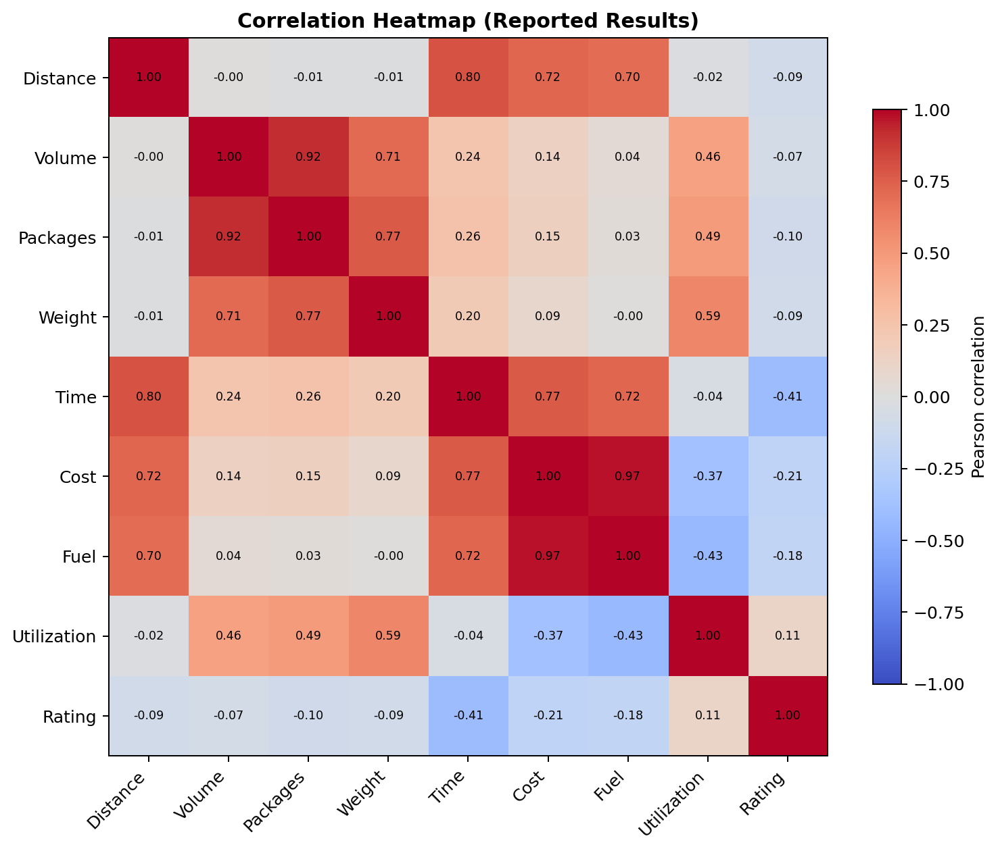
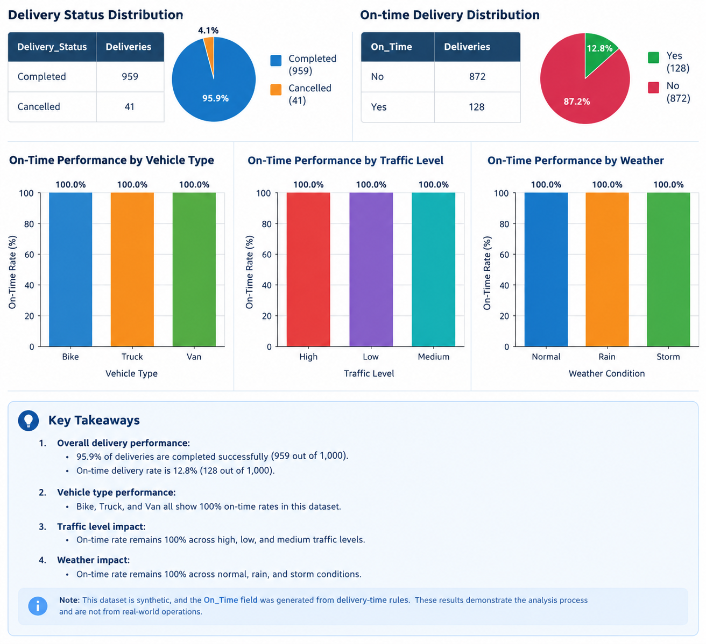
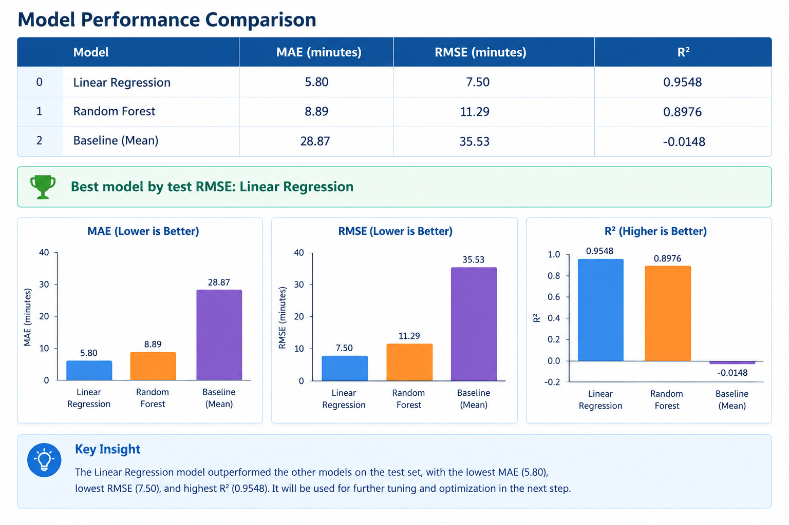

# 🚚 Logistics Data Analytics: End-to-End Project

**A four-task logistics analytics project using Python, data analysis, visualization, machine learning, and optimization.**

## 📌 Project Overview

This project demonstrates an end-to-end data analytics workflow for logistics and supply chain operations. It progresses from strategic planning and data exploration to data cleaning, advanced analysis, predictive modeling, and operational optimization.

The project focuses on how data-driven techniques can help logistics businesses understand delivery performance, improve data quality, identify operational patterns, predict delivery times, and make better dispatch decisions.

The work is organized into four tasks, each addressing a different stage of the analytics process.

## 🎯 Project Objectives

- Develop a strategic approach to solving logistics problems using data science.
- Understand logistics datasets and identify relevant Key Performance Indicators (KPIs).
- Prepare high-quality data through cleaning and preprocessing.
- Explore trends, distributions, correlations, and operational bottlenecks.
- Build and evaluate machine learning models for delivery-time prediction.
- Investigate optimization strategies that may improve logistics efficiency.
- Communicate findings through reports, Python code, and visualizations.

## 🗂️ Project Tasks

### Task 1: Strategic Planning and Data Exploration in Logistics

**Folder:** [Week 1 — Strategic Planning](./Week-1/)

**Objective:** Define a logistics problem and establish a data-driven strategy for analyzing and improving operations.

**Work covered:**
- Define a realistic logistics scenario and its business challenges.
- Establish relevant KPIs, such as average delivery time, on-time delivery rate, and vehicle capacity utilization.
- Research publicly available data sources and relevant analytical techniques.
- Identify how regression, clustering, and optimization could address logistics challenges.
- Develop an end-to-end analytical roadmap using Python.
- Include Python pseudocode or code snippets illustrating the proposed approach.

**Deliverable:** A strategic planning report documenting the scenario, objectives, research, KPIs, methodology, and analytical roadmap.

### Task 2: Data Collection, Cleaning, and Preprocessing for Logistics Analysis

**Folder:** [Week 2 — Data Preprocessing](./Week-2/)

**Objective:** Prepare logistics data for reliable analysis by identifying and addressing data-quality issues.

**Work covered:**
- Select or simulate a relevant logistics dataset.
- Inspect dataset structure, column types, missing values, and duplicate records.
- Identify potential outliers and inconsistent values.
- Apply suitable cleaning and missing-value handling techniques.
- Perform normalization or standardization where appropriate.
- Document preprocessing decisions using Python libraries such as Pandas and NumPy.

**Deliverable:** A data preprocessing report explaining the dataset, cleaning methodology, Python code, and the importance of data quality in logistics decision-making.

### Task 3: Advanced Data Analysis and Visualization in Logistics

**Folder:** [Week 3 — Data Analysis and Visualization](./Week-3/)

**Objective:** Analyze logistics data to uncover operational patterns and communicate findings through visualizations.

**Work covered:**
- Conduct exploratory data analysis (EDA).
- Calculate descriptive statistics, including measures of central tendency and distribution.
- Examine correlations and relationships among logistics variables.
- Create visualizations using Matplotlib, Seaborn, or other suitable Python tools.
- Interpret trends in delivery times, shipment volumes, transportation costs, and operational performance.
- Identify potential bottlenecks and develop data-driven recommendations.

**Deliverable:** An analytical report containing the methodology, Python code, visualizations, interpretations, and recommendations.

### Task 4: Predictive Modeling and Optimization in Logistics Systems

**Folder:** [Week 4 — Predictive Modeling and Optimization](./Week-4/)

**Objective:** Develop a machine learning model to predict delivery times and explore dispatch-time optimization.

**Work covered:**
- Create a synthetic logistics dataset for delivery-time prediction.
- Prepare numerical and categorical features using a Scikit-learn preprocessing pipeline.
- Train and compare Linear Regression and Random Forest models.
- Evaluate models using Mean Absolute Error (MAE), Root Mean Squared Error (RMSE), and R².
- Apply cross-validation and hyperparameter tuning to select a suitable Ridge Regression model.
- Simulate alternative dispatch hours to estimate potential delivery-time savings.

**Deliverable:** A predictive modeling report documenting the dataset, model selection, training, validation, evaluation results, optimization simulation, and recommendations.

## 🛠️ Technologies and Tools

| Category | Tools and Techniques |
|---|---|
| Programming language | Python |
| Development environment | Google Colab |
| Data manipulation | Pandas, NumPy |
| Data visualization | Matplotlib, Seaborn |
| Machine learning | Scikit-learn |
| Data preprocessing | StandardScaler, OneHotEncoder, ColumnTransformer, Pipeline |
| Model evaluation | MAE, RMSE, R², cross-validation |
| Hyperparameter tuning | GridSearchCV |
| Documentation and version control | Microsoft Word, Git, GitHub |

## 🔄 Project Workflow

The project follows a structured analytical process:

1. **Strategic planning:** Define the logistics problem, objectives, KPIs, and analysis strategy.
2. **Data collection and preparation:** Select or simulate data, inspect its quality, and preprocess relevant features.
3. **Exploratory analysis:** Calculate statistics, visualize patterns, and identify operational insights.
4. **Predictive modeling:** Train, validate, compare, and tune machine learning models.
5. **Optimization:** Simulate alternative dispatch decisions and estimate potential improvements.
6. **Reporting:** Document the methodology, results, limitations, and recommendations.

## 📊 Task 4: Dataset Overview

The predictive modeling task uses a synthetic dataset containing **1,500 records and 12 columns**, including 11 input features and one target variable.

| Feature | Description |
|---|---|
| `Distance_KM` | Shipment distance in kilometers |
| `Package_Count` | Number of packages |
| `Load_Weight_KG` | Total shipment weight |
| `Shipment_Volume` | Shipment volume |
| `Vehicle_Type` | Type of delivery vehicle |
| `Traffic_Level` | Traffic conditions |
| `Weather_Condition` | Weather conditions |
| `Destination_Zone` | Delivery destination zone |
| `Dispatch_Hour` | Hour of dispatch |
| `Day_of_Week` | Day of the week |
| `Rush_Hour` | Indicator of rush-hour conditions |
| `Delivery_Time_Minutes` | Target variable representing delivery time |

The reported dataset checks found no missing values or duplicate records.

The data was divided into training and testing sets using an 80:20 split, resulting in 1,200 training records and 300 testing records.

Numerical features were standardized, while categorical features were one-hot encoded. The preprocessing steps were integrated into a Scikit-learn pipeline.

## 🤖 Task 4: Model Performance

The following are the reported test-set results from the predictive modeling task.

| Model | MAE | RMSE | R² |
|---|---:|---:|---:|
| Linear Regression | 5.798 | 7.496 | 0.9548 |
| Random Forest | 8.890 | 11.290 | 0.8976 |
| Tuned Ridge Regression | 5.796 | 7.493 | 0.9549 |
| Mean baseline | 28.870 | 35.530 | -0.0148 |

**Key findings:**
- Tuned Ridge Regression achieved the best reported test metrics.
- The model achieved an R² of approximately 0.955, indicating that it explained about 95.5% of the target variance on the test set.
- Five-fold cross-validation and GridSearchCV were used during model selection and hyperparameter tuning.
- Ridge Regression provided only a very small improvement over Linear Regression, so its practical advantage should not be overstated.

## 🚦 Dispatch-Time Optimization

A dispatch-time simulation was performed on 20 test deliveries. Candidate dispatch hours between 06:00 and 22:00 were evaluated by changing the dispatch hour and corresponding rush-hour indicator.

**Reported simulation results:**
- Average estimated delivery-time saving: **4.45 minutes per delivery**
- Deliveries with a positive estimated improvement: **20 out of 20**
- Selected dispatch hour in the simulation: **06:00**

These results are illustrative rather than proof of real-world operational savings. The synthetic data and simulation assumptions influence the results, and only the dispatch hour was varied.

A real logistics implementation would also need to consider driver availability, vehicle capacity, delivery windows, route conditions, depot operating hours, and customer requirements.

## 📈 Visualizations

The Task 4 analysis includes the following visualizations:

1. **Model Performance Comparison** — compares the predictive accuracy of the evaluated models.
2. **Actual vs. Predicted Delivery Times** — shows how closely predicted values match observed test-set values.
3. **Dispatch Optimization Savings** — illustrates the estimated delivery-time savings from the dispatch simulation.

```markdown






```
## 📁 Repository Structure

```
Logistics-Data-Analyst-Intern/
│
├── README.md
│
├── Week-1/
│   ├── data/
│   ├── figures/
│   ├── notebooks/
│   ├── reports/
│   └── README.md
│
├── Week-2/
│   ├── data/
│   ├── figures/
│   ├── notebooks/
│   ├── reports/
│   └── README.md
│
├── Week-3/
│   ├── data/
│   ├── figures/
│   ├── notebooks/
│   ├── reports/
│   └── README.md
│
└── Week-4/
    ├── data/
    ├── figures/
    ├── notebooks/
    ├── reports/
    └── README.md
```


## ▶️ How to Run the Project

The reports and notebooks may be reviewed directly through their respective GitHub folders.

To run Python analysis locally:

**1. Clone the repository**

```bash
git clone https://github.com/AdarshSharma-v10/Logistics-Data-Analyst-Intern.git
cd Logistics-Data-Analyst-Intern
```

**2. Install the main Python libraries**

## Installation and Requirements

This project was developed and executed using **Google Colab**, so no local installation is required to run the notebooks.

### Tools and Requirements

- **Python 3** — programming language
- **Google Colab** — cloud-based development environment
- **Pandas** — data manipulation and analysis
- **NumPy** — numerical computations
- **Matplotlib and Seaborn** — data visualization
- **Scikit-learn** — data preprocessing, machine learning, model evaluation, and hyperparameter tuning
- **CSV files** — storing and exporting analysis results

### Setup

1. Open the project notebook in Google Colab.
2. Upload the required dataset or CSV files, if needed.
3. Run the notebook cells sequentially to perform the analysis.
4. Download the generated CSV results and visualizations as required.

Most required libraries are pre-installed in Google Colab. If any library is missing, install the dependencies by running the following command:

```
!pip install pandas numpy matplotlib seaborn scikit-learn
```

Alternatively, open the relevant notebook in Google Colab and execute the cells in sequence. Ensure that the required datasets are available and that all input and output paths are configured correctly.

## 💡 Overall Outcomes

This project demonstrates how Python-based data analytics can support logistics decision-making through:

- Structured problem definition and KPI selection.
- Systematic data cleaning and preprocessing.
- Statistical analysis and exploratory data visualization.
- Predictive modeling and model performance evaluation.
- Simulation-based optimization and data-driven recommendations.

The predictive modeling task achieved strong reported performance on the test set using synthetic data. However, further validation with real-world operational data is necessary before deploying the model or implementing dispatch recommendations in a production environment.

## 🔮 Future Improvements

- Validate the analytical workflow using real-world logistics datasets.
- Incorporate geographical data, route information, and time-dependent traffic conditions.
- Explore additional regression algorithms and more robust model validation techniques.
- Optimize delivery routes while accounting for vehicle capacity and delivery constraints.
- Evaluate dispatch strategies based on operational costs and service-level requirements.
- Develop interactive dashboards to monitor logistics KPIs and model predictions.

## 👨‍💻 Author

**Adarsh Sharma**

- **GitHub Profile:** [AdarshSharma-v10](<https://github.com/AdarshSharma-v10>)
- **Project Repository:** [Logistics Data Analyst Intern](<https://github.com/AdarshSharma-v10/Logistics-Data-Analyst-Intern>)